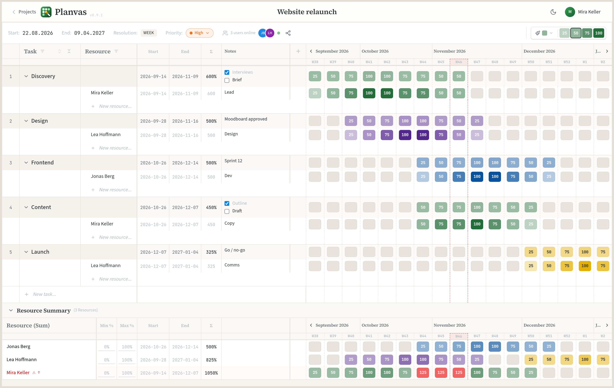
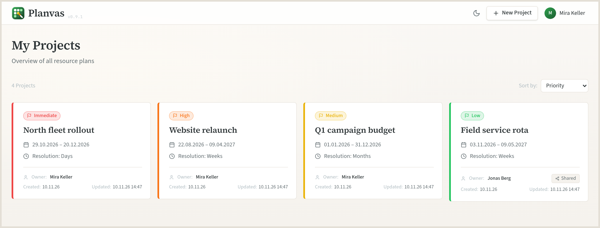
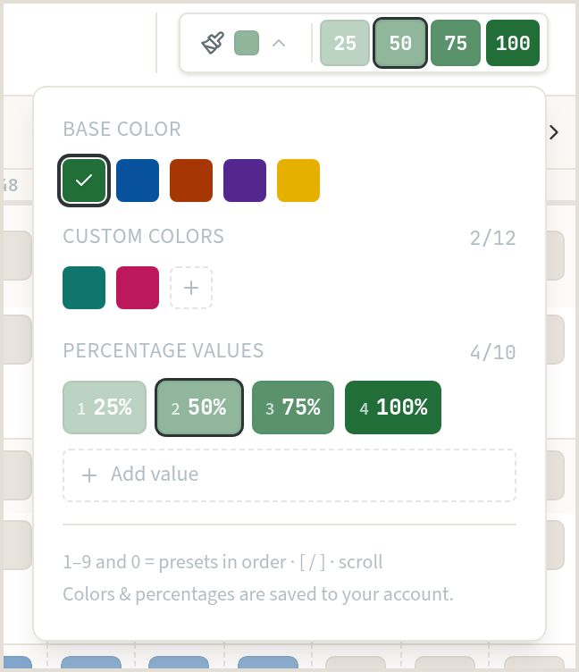
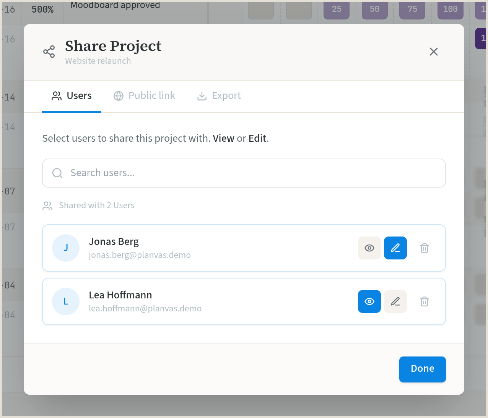

<div align="center">


# Planvas

**Paint who does what, when, and at what capacity.**

[](https://nextjs.org/)
[](https://pocketbase.io/)
[](https://www.docker.com/)
[](https://opensource.org/licenses/MIT)


</div>

Planvas is a self-hosted resource planner. You paint allocations onto a timeline — day, week, month or year — and read the load straight from the grid. It stays small on purpose: no dependency graph and no ticket tracker, just the plan.

People, rooms, vehicles, budget lines: a row is any resource you need to place in time. Colors separate plans, teams or “target vs. actual”. The same person’s rows roll up into a summary, and anything over 100% turns red.

## Screenshots

### Planning grid

Week view of a relaunch. Shade is the percentage, color is the brush. The dotted column is today. Notes are Markdown, so `- [ ]` tasks can be ticked in the cell. Avatars are teammates in this plan right now. The summary adds a person up across tasks — the red cells are over 100%.



### Projects

Every plan shows its priority, date range, resolution and owner. A plan someone shared with you is marked.



### Brush

Five base colors, your own colors, and percentage presets. They are stored on your account. Keys `1`–`9` and `0` select a preset; `[` and `]` or the scroll wheel cycle them.

A resource can also have its own color: click the dot in front of its name. The color belongs to the name, so every “Anna” in the plan shares it, and a new “Anna” picks it up. Those rows then always paint in that color, whatever the brush base color is; the brush bar and the cursor preview switch to it while you hover such a row. Cells painted earlier keep their color unless you tick “recolor existing allocations”.

<p align="center">
  
</p>

### Sharing

Give someone view or edit access. The same dialog turns on a public view-only link (no account) and downloads a CSV — one row per allocation.

<p align="center">
  
</p>

## Features

**Planning**

- Click and drag to paint. Click the same cell again to clear it.
- Optional color per resource name; it overrides the brush color on those rows.
- Day, week, month or year. The current period stays centered; paging moves a full window.
- Project priorities: Immediate, High, Medium, Low, On hold.
- Custom columns with Markdown. Checkboxes toggle in the rendered cell.
- One level of subtasks.
- Per-column filters, including select all / clear.
- Task, resource and custom columns size to their content. Drag an edge to override, double-click it to go back to automatic.
- Sticky headers and frozen columns while you scroll.
- Resource summary with a min/max band and a highlight when a period is over or under.

**Together**

- Live updates over PocketBase, plus who is in the plan right now.
- Share a project as view or edit.
- Public view-only link at `/share/[token]`.
- CSV export from the share dialog.

**The app**

- English and German.
- Light, dark, or follow the system.
- Desktop and tablet.
- One Docker Compose stack for production: nginx, Next.js, PocketBase, SQLite on a volume.

## Develop

Node.js 18+ and Docker.

```bash
git clone https://github.com/CeeFeS/Planvas.git
cd Planvas
npm install

# Browser talks to PocketBase directly in dev.
printf 'NEXT_PUBLIC_POCKETBASE_URL=http://127.0.0.1:8090\n' > .env.local

npm run pocketbase:start   # http://127.0.0.1:8090  (migrations run on boot)
npm run dev                # http://localhost:3000
```

The first visit is a setup screen: create the admin account and start a plan. PocketBase data stays in the Docker volume `tinyplanvas_pocketbase_data`.

`npm run pocketbase:stop` stops PocketBase. `npm run pocketbase:reset` asks for confirmation, then deletes the volume.

## Self-host

```bash
git clone https://github.com/CeeFeS/Planvas.git
cd Planvas
docker compose up -d --build
```

Open `http://your-server/` (port 80, or `APP_PORT` in a `.env` file). Leave `NEXT_PUBLIC_POCKETBASE_URL` empty so the browser uses the same origin; nginx routes `/api` to PocketBase. The setup screen creates the first admin.

```
nginx :80
  ├─ Next.js :3000
  └─ PocketBase :8080 → SQLite volume
```

<details>
<summary>Server, environment, backup</summary>

- Linux, Docker Engine 24+, Compose v2
- 1 GB RAM (2 GB is more comfortable), 10 GB disk

```env
APP_PORT=80
# Empty = same origin through nginx. Set only if the browser must call PocketBase elsewhere.
NEXT_PUBLIC_POCKETBASE_URL=
```

The volume is named `tinyplanvas_pocketbase_data` (from the project’s former name) so an existing install keeps its data.

```bash
# Backup
docker run --rm -v tinyplanvas_pocketbase_data:/data -v "$(pwd)":/backup alpine \
  tar czf /backup/pb_backup.tar.gz /data

# Restore (stop the stack first)
docker run --rm -v tinyplanvas_pocketbase_data:/data -v "$(pwd)":/backup alpine \
  tar xzf /backup/pb_backup.tar.gz -C /
```

</details>

## Stack

| | |
|---|---|
| Frontend | Next.js 14, React 18, TypeScript, Tailwind CSS |
| State | Zustand |
| Backend | PocketBase, SQLite |
| Deploy | Docker Compose, nginx |

```
src/app            Next.js routes (dashboard, project, public share)
src/components     grid, brush, sharing, auth
src/lib            API client, i18n, types
pocketbase         migrations and PocketBase image
nginx              reverse proxy
```

## Roadmap

Already in: dark mode, public links, CSV export, priorities, custom columns, filters, resource colors.

Not yet: a public REST API, PDF and Excel export. Ideas past that — calendar sync, utilization charts, overallocation notices — belong in a GitHub issue.

## Contributing

Bug reports, ideas and pull requests are welcome. Please open an issue first for anything large.

## License

[MIT](LICENSE)

<div align="center">

[Report a bug](https://github.com/CeeFeS/Planvas/issues) · [Request a feature](https://github.com/CeeFeS/Planvas/issues)

</div>
